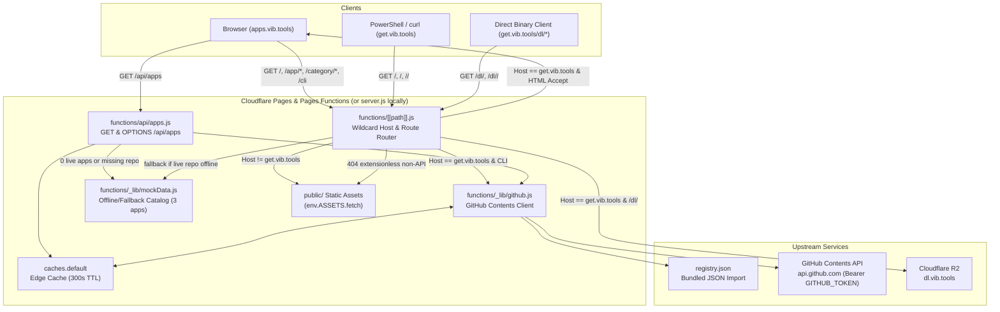
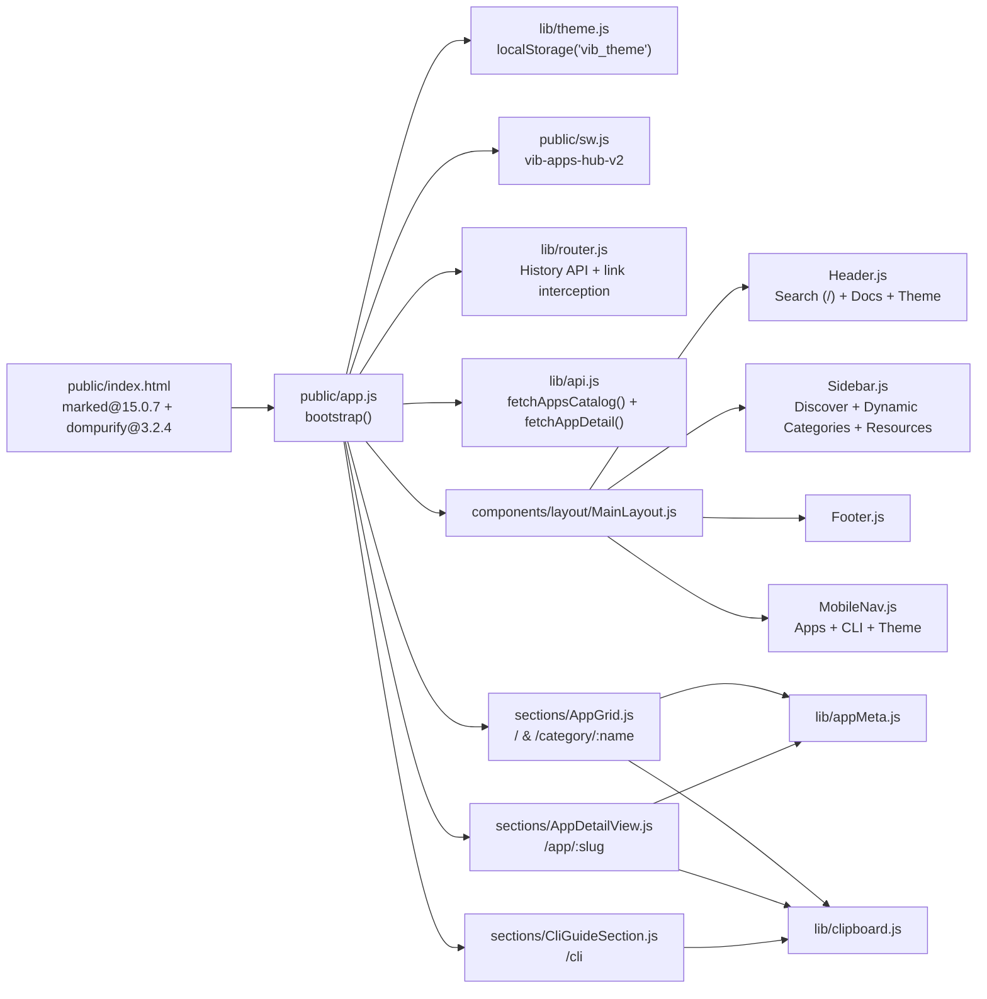

# System Architecture & Data Flow

`vib-apps-hub` eliminates build pipelines and external databases by combining static ES-module delivery from `public/` with edge compute in `functions/`.

## 1. End-to-End Request Architecture

## 2. Frontend SPA Architecture (`public/`)

The browser client executes directly via native ES modules without transpilation:

### Bootstrap Sequence (`public/app.js`)

1. Calls `initTheme()` to set `[data-theme]` (`dark` default) and `<meta name="theme-color">`.
2. Registers `/sw.js` on `http:` / `https:` origins.
3. Reads initial `?q=` query parameter and parses `window.location.pathname` via `getCurrentRoute()`.
4. Mounts `MainLayout` into `#app` and immediately renders loading skeletons so first paint is never blank.
5. Calls `fetchAppsCatalog()` (`/api/apps`), computes dynamic sorted category counts via `computeCategoryCounts()`, updates the sidebar, and re-renders active catalog views without disrupting already-open `/app/:slug` or `/cli` views.
6. Updates `document.title` dynamically on every route transition via `updateDocumentTitle(route)`.

## 3. Data & Caching Pipeline

`vib-apps-hub` uses **four distinct caching tiers** (no database):

| Tier | Location | Scope | TTL / Invalidation |
| :--- | :--- | :--- | :--- |
| **1. Edge Per-File Cache** | `functions/_lib/github.js` (`caches.default`) | Individual GitHub files under `https://apps.vib.tools/__cache/gh/<repo>/<branch>/<path>` | `300s` (`max-age=300`) |
| **2. Edge Catalog Cache** | `functions/api/apps.js` (`caches.default`) | Aggregated Mode A JSON payload under `https://apps.vib.tools/__cache/api/apps/catalog` | `300s` (`X-Cache-Status: HIT \| MISS`) |
| **3. Client In-Memory Cache** | `public/lib/api.js` (`catalogCache`) | Mode A catalog payload for the current browser tab session (`fetchAppsCatalog(forceRefresh)`) | Page reload or `forceRefresh = true` |
| **4. PWA Service Worker Cache** | `public/sw.js` (`vib-apps-hub-v2`) | 33 precached static shell assets; Stale-While-Revalidate for static files; Network-First for `/api/*` and HTML navigation | Cache version bump (`CACHE_NAME`) |

> **Local Emulation Note:** In Node.js (`server.js`), `globalThis.caches.default` is polyfilled with an in-memory `Map` honoring `Cache-Control: max-age=<N>` headers so edge caching behaves identically during local testing.

## 4. Fallback & Resilience Design

`registry.json` currently ships with a single placeholder entry (`example-app` → `vib-tools/example-app`). Whenever live GitHub requests return 404, hit rate limits, or run offline:

- **Mode A (`/api/apps`):** `Promise.allSettled()` logs and skips failed entries; if `apps.length === 0`, `getMockApps()` returns 3 schema-compliant sample applications (`calgrid`, `devprompt`, `vibclip`).
- **Mode B (`/api/apps?slug=<slug>`):** Falls back to `findMockApp(slug)` + `getMockDoc(slug, "features" | "changelog")`.
- **Edge Installer & Direct Download (`get.vib.tools`):** Falls back to `findMockApp(slug)` and `getMockInstaller(slug)`.

## Related Guides

- [Codebase Structure & Module Inventory](./02-codebase-structure.md)
- [Store API & Edge Routing Reference](./04-api-and-edge-routing.md)
- [Local Setup & Cloudflare Deployment](./06-local-setup-and-deployment.md)
