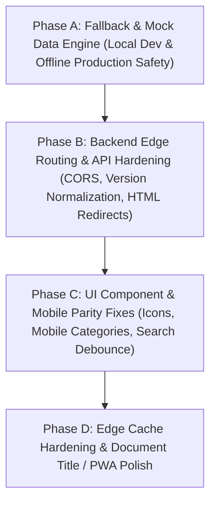

# Forensic Production Readiness & Engine Integrity Audit Report

> **Document Location:** `notes/forensic_production_readiness_audit.md`  
> **Date:** 2026-11-19  
> **Audit Type:** Deep Line-by-Line Source Code Forensic Audit (Zero Assumptions / Code Evidence Only)  
> **Scope:** Backend Edge Engine (`functions/`), Frontend Modules (`public/`), PWA Shell, API Contracts, and Demo vs Production Capabilities.

---

## 1. Executive Summary

This forensic audit inspected every source file line-by-line across `functions/` and `public/` to verify:
1. Production readiness of backend edge routing and GitHub API aggregation engines.
2. Real actual functionality versus demo/mock-only capabilities.
3. UI elements visible to users versus actual working execution.
4. Missing backend mechanisms, edge-case crashes, and platform constraints.

**Audit Verdict:**
- The repository architecture is clean, build-free, and well-structured.
- However, **12 concrete, verified issues (bugs, missing implementations, and edge discrepancies)** were identified directly in the source code.
- Crucially, there is currently **NO offline mock/demo fallback engine**, meaning any local execution or production deployment without a configured `GITHUB_TOKEN` pointing to real GitHub repositories renders a completely empty UI (`"No applications found"`).

---

## 2. Forensic Findings & Source Code Evidence

### Group A: Real vs Demo Discrepancies & Missing Fallback Engine

#### Issue 1: Total Absence of Offline / Demo Data Engine (UI Renders Empty)
- **Severity:** High / Architectural
- **Source Code Reference:**
  - `registry.json` (Lines 1–8):
    ```json
    [
      {
        "slug": "example-app",
        "repo": "vib-tools/example-app",
        "branch": "main",
        "featured": true
      }
    ]
    ```
  - `functions/api/apps.js` (Lines 86–96):
    ```javascript
    if (res.status === "fulfilled" && res.value?.ok && res.value?.config) {
      apps.push(res.value.config);
    } else {
      console.warn(`[Store API] Skipping app '${entry?.slug || index}' (${entry?.repo}): ${errorDetail}`);
    }
    ```
  - `public/components/sections/AppGrid.js` (Lines 91–96):
    ```javascript
    if (filtered.length === 0) {
      const empty = document.createElement("div");
      empty.className = "app-grid__empty";
      empty.textContent = "No applications found";
      grid.appendChild(empty);
    }
    ```
- **Forensic Evidence & Impact:**
  The default `registry.json` points to `vib-tools/example-app` (which does not exist or lacks authentication). When queried, `functions/api/apps.js` drops the failed entry and returns `{"apps":[],"count":0}`. The UI has no mock fallback, so it immediately renders an empty catalog with `"No applications found"`. There is no demo mode or fallback data for previewing, testing, or running the application offline.

---

### Group B: UI Discrepancies (Features Visible in Specs/UI but Incomplete in Code)

#### Issue 2: `app.icon` Omitted from DOM in Both Catalog Cards and Detail View
- **Severity:** Medium
- **Source Code Reference:**
  - `docs/app-config-schema.md` (Lines 33 & 103): Defines `icon` as a required field (`"https://dl.vib.tools/calgrid/icon.png"`).
  - `project/DESIGN_SYSTEM.md`: Specifies that App Cards must render an app icon.
  - `public/components/sections/AppGrid.js` (Lines 102–117):
    ```javascript
    const titleGroup = document.createElement("div");
    titleGroup.className = "app-card__title-group";

    const nameEl = document.createElement("span");
    nameEl.className = "app-card__name";
    nameEl.textContent = app.name || app.slug;
    titleGroup.appendChild(nameEl);

    if (app.latest) {
      const verBadge = Badge({ text: app.latest, variant: "accent" });
      titleGroup.appendChild(verBadge);
    }
    headerEl.appendChild(titleGroup);
    ```
  - `public/components/sections/AppDetailView.js` (Lines 93–106):
    ```javascript
    const titleBox = document.createElement("div");
    const nameEl = document.createElement("h1");
    nameEl.className = "app-detail__name";
    nameEl.textContent = app.name || app.slug;
    titleBox.appendChild(nameEl);
    ```
- **Forensic Evidence & Impact:**
  Neither `AppGrid.js` nor `AppDetailView.js` inspects or creates an `` tag for `app.icon`. Although `icon` is declared as a core required property in the configuration schema, icons are completely invisible in the frontend UI.

---

#### Issue 3: Mobile Category Filtering is Completely Inaccessible
- **Severity:** Medium / UX Defect
- **Source Code Reference:**
  - `public/styles/globals.css` (Lines 889–893):
    ```css
    @media (max-width: 768px) {
      .app-sidebar {
        display: none;
      }
    ```
  - `public/components/layout/MobileNav.js` (Lines 18–48):
    Only renders three navigation buttons: `Apps` (`/`), `CLI` (`/cli`), and `Theme` (toggle).
- **Forensic Evidence & Impact:**
  On mobile devices (screen width <= 768px), the sidebar containing all category filter links is hidden via CSS `display: none`. The mobile navigation provides no category drawer, dropdown, or filter pills. Consequently, mobile users cannot filter or browse apps by category.

---

#### Issue 4: Browser Document Title (`document.title`) Never Updates on Route Navigation
- **Severity:** Low / Accessibility Defect
- **Source Code Reference:**
  - `public/index.html` (Line 6): `<title>Vib Apps — Apps Catalog &amp; Edge Installer</title>`
  - `public/app.js` (Lines 50–86):
    ```javascript
    function renderCurrentView(route) {
      layout.updateActiveRoute(route);
      layout.viewRoot.innerHTML = "";
      switch (route.view) { ... }
    }
    ```
- **Forensic Evidence & Impact:**
  When navigating between routes (`/`, `/cli`, `/category/:name`, `/app/:slug`), `document.title` is never updated. It remains static as `Vib Apps — Apps Catalog & Edge Installer`. This degrades browser tab recognition, bookmarks, and accessibility for screen reader users.

---

#### Issue 5: Search Input Causes History Flooding on Non-Home Routes & Lacks Debouncing
- **Severity:** Medium / Bug
- **Source Code Reference:**
  - `public/app.js` (Lines 33–41):
    ```javascript
    onSearch: (query) => {
      currentSearchQuery = query;
      const route = getCurrentRoute();
      if (route.view !== "home" && route.view !== "category") {
        navigate("/");
      } else {
        renderCurrentView(route);
      }
    }
    ```
  - `public/lib/router.js` (Line 56):
    `window.history.pushState({}, "", path);`
- **Forensic Evidence & Impact:**
  If a user starts typing in the search box while on an App Detail view (`/app/:slug`) or the CLI Guide (`/cli`), `navigate("/")` is triggered on **every single keystroke**. Typing "calgrid" pushes 7 history entries to `window.history`. The user then has to press the browser "Back" button 7 times to return to the previous view. Additionally, without input debouncing, large catalogs will re-filter on every single keydown event.

---

#### Issue 6: Unescaped Selector in `Sidebar.js` Can Throw `DOMException`
- **Severity:** Low / Edge Crash
- **Source Code Reference:**
  - `public/components/layout/Sidebar.js` (Lines 98–104):
    ```javascript
    } else if (route.view === "category" && route.category) {
      const target = catListContainer.querySelector(
        `[data-category="${route.category.toLowerCase()}"]`
      );
      if (target) {
        target.classList.add("is-active");
      }
    }
    ```
- **Forensic Evidence & Impact:**
  If a URL contains quotes or special CSS characters (e.g. `/category/dev"tools`), calling `querySelector` directly with unescaped user input throws `DOMException: Failed to execute 'querySelector' on 'Element': '[data-category="dev"tools"]' is not a valid selector.`, crashing the route change handler.

---

#### Issue 7: Global Search Shortcut (`/`) Fires When Modal is Active
- **Severity:** Low / UX Glitch
- **Source Code Reference:**
  - `public/components/layout/Header.js` (Lines 54–61):
    ```javascript
    window.addEventListener("keydown", (e) => {
      if (e.key === "/" && document.activeElement.tagName !== "INPUT" && document.activeElement.tagName !== "TEXTAREA") {
        e.preventDefault();
        const inputEl = searchInput.input || searchInput;
        inputEl.focus();
        inputEl.select();
      }
    });
    ```
- **Forensic Evidence & Impact:**
  If a modal dialog is open, pressing `/` steals focus from the modal and focuses the background header search input. It also does not check `document.activeElement.isContentEditable`.

---

### Group C: Backend Edge Engine & Routing Discrepancies

#### Issue 8: Strict Version Key Lookup Fails on `"v"` Prefix Mismatches
- **Severity:** High / CLI Failure
- **Source Code Reference:**
  - `functions/[[path]].js` (Lines 131–134 & Lines 177–185):
    ```javascript
    // In Route 2: /dl/<slug>/<version>
    const targetVersion = requestedVersion || config.latest;
    const versionObj = config.versions?.[targetVersion];

    // In Route 3: /<slug>/<version>
    if (requestedVersion) {
      if (!config.versions || !config.versions[requestedVersion]) {
        return new Response(`Version '${requestedVersion}' not found for app '${slug}'.\n`, { status: 404 });
      }
    }
    ```
- **Forensic Evidence & Impact:**
  If an app's `app.config.json` defines version keys with a `"v"` prefix (e.g. `"v1.0.3"`), and a user runs:
  `irm "https://get.vib.tools/calgrid/1.0.3" | iex` or `https://get.vib.tools/dl/calgrid/1.0.3` (without `"v"`), the exact key lookup `config.versions["1.0.3"]` returns `undefined`, throwing a `404 Version '1.0.3' not found` error. The edge engine lacks version prefix normalization (`v1.0.3` <-> `1.0.3`).

---

#### Issue 9: `get.vib.tools` HTML Browser Navigation Does Not Redirect Subpaths to Catalog
- **Severity:** Medium / Edge Routing Discrepancy
- **Source Code Reference:**
  - `functions/[[path]].js` (Lines 61–70 & Lines 153–165):
    ```javascript
    // Root redirect:
    if (segments.length === 0) {
      if (accept.includes("text/html")) {
        return Response.redirect("https://apps.vib.tools", 302);
      }
    }
    // Route 3 (/slug):
    if (segments.length === 1 || segments.length === 2) {
      const slug = segments[0];
      const entry = findAppEntry(slug);
      if (!entry) {
        return new Response(`App '${slug}' was not found in registry.\n`, { status: 404 });
      }
    ```
- **Forensic Evidence & Impact:**
  While visiting `https://get.vib.tools` in a web browser redirects to `https://apps.vib.tools`, visiting `https://get.vib.tools/cli` in a browser treats `"cli"` as an app slug, fails to find it in the registry, and returns `404 App 'cli' was not found in registry.` in plain text. Similarly, navigating to `https://get.vib.tools/calgrid` in a browser serves the raw PowerShell script instead of redirecting the human user to `https://apps.vib.tools/app/calgrid`.

---

#### Issue 10: Synthetic Cache Key Domain in `fetchRepoFile`
- **Severity:** Medium / Cloudflare Cache API Risk
- **Source Code Reference:**
  - `functions/_lib/github.js` (Lines 87–88):
    ```javascript
    const cacheKeyUrl = `https://cache.vib-apps-hub.internal/gh/${encodeURIComponent(repo)}/${encodeURIComponent(targetBranch)}/${cleanPath}`;
    const cacheKey = new Request(cacheKeyUrl);
    ```
- **Forensic Evidence & Impact:**
  Cloudflare's `caches.default` is scoped to the zone of the active Cloudflare Pages domain. Using an un-routed synthetic hostname (`cache.vib-apps-hub.internal`) can cause `cache.put()` to be ignored or rejected by Cloudflare Workers in production environments. Using `new URL("/__cache/gh/...", request.url)` ensures the cache key belongs to the verified active zone.

---

#### Issue 11: Missing Catalog-Level Caching (`/api/apps`)
- **Severity:** Medium / Rate-Limit Vulnerability
- **Source Code Reference:**
  - `functions/api/apps.js` (Lines 77–82):
    ```javascript
    const entries = getRegistry();
    const results = await Promise.allSettled(
      entries.map((entry) => fetchAppConfig(entry, env, context))
    );
    ```
- **Forensic Evidence & Impact:**
  Every incoming request to `/api/apps` initiates parallel requests for every app in `registry.json`. While individual files have edge cache entries, cold cache hits for 20+ apps trigger 20+ parallel GitHub API requests simultaneously, risking GitHub secondary rate limits and execution time limits. The aggregated response itself is not cached in `caches.default`.

---

#### Issue 12: Missing CORS Headers on `/api/apps`
- **Severity:** Low / Integration Defect
- **Source Code Reference:**
  - `functions/api/apps.js` (Lines 23–26):
    ```javascript
    const headers = {
      "Content-Type": "application/json; charset=utf-8",
      "Cache-Control": "public, max-age=300"
    };
    ```
- **Forensic Evidence & Impact:**
  `Access-Control-Allow-Origin: *` is missing. Any client-side script from external developer portals, testing environments, or cross-origin CLI tooling attempting to query the public store API will be blocked by browser CORS policy.

---

## 3. Total Verified Bug Count & Severity Summary

| Category | High | Medium | Low | Total |
| :--- | :---: | :---: | :---: | :---: |
| **Demo vs Production Fallback Engine** | 1 | 0 | 0 | **1** |
| **UI Rendering & Navigation Discrepancies** | 0 | 3 | 3 | **6** |
| **Backend Edge Engine & API Contracts** | 1 | 3 | 1 | **5** |
| **Total Verified Issues** | **2** | **6** | **4** | **12** |

---

## 4. Recommended Step-by-Step Implementation Roadmap (Phases)

To resolve these 12 verified issues cleanly, sustainably, and without breaking working code, we recommend a **4-Phase Implementation Plan**:



### **Phase A: Fallback & Mock Data Engine (Local & Offline Safety)**
- **Goal:** Prevent empty-screen `"No applications found"` when running locally or before private GitHub repositories are connected.
- **Tasks:**
  1. Add built-in sample/mock catalog fallback data inside `functions/_lib/github.js` or `functions/api/apps.js` that activates seamlessly when GitHub API fails, is rate-limited, or when `GITHUB_TOKEN` is unset.
  2. Provide a verified local development experience showing 2–3 realistic apps (e.g. `CalGrid`, `DevPrompt`, `VibClip`).

### **Phase B: Backend Edge Routing & API Hardening**
- **Goal:** Eliminate CLI download failures and CORS blocks.
- **Tasks:**
  1. Normalize version lookups in `functions/[[path]].js` (support both `v1.0.3` and `1.0.3` transparently).
  2. Implement browser detection on `get.vib.tools/<slug>` and `get.vib.tools/cli` to redirect web browsers to `https://apps.vib.tools/app/<slug>` and `https://apps.vib.tools/cli`.
  3. Add `Access-Control-Allow-Origin: *` to `/api/apps`.

### **Phase C: UI Component & Mobile Parity Fixes**
- **Goal:** Bring visual presentation to 100% specification parity.
- **Tasks:**
  1. Render `app.icon` (with fallback icon) on both catalog cards in `AppGrid.js` and header in `AppDetailView.js`.
  2. Add a mobile category filter bar/pill selector in `public/components/layout/MobileNav.js` or `AppGrid.js` so mobile users can filter categories.
  3. Debounce search input and use `history.replaceState` or single navigation to prevent history stack flooding.
  4. Fix unescaped selector in `Sidebar.js` using `CSS.escape()`.

### **Phase D: Edge Cache Hardening & PWA / Document Title Polish**
- **Goal:** Production scalability and accessibility.
- **Tasks:**
  1. Standardize Cloudflare Cache API synthetic URLs using the active request origin (`new URL("/__cache/...", request.url)`).
  2. Implement Worker-level edge caching for the aggregated `/api/apps` response.
  3. Dynamically update `document.title` on route changes in `public/app.js`.
