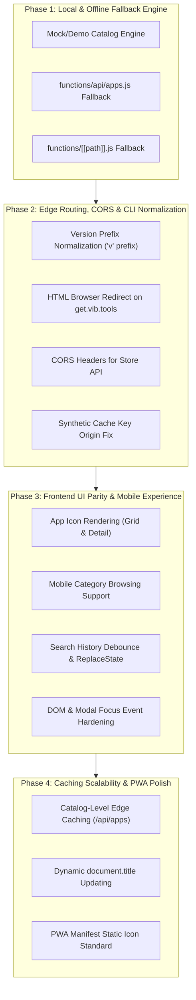

# Production Readiness & Incremental BugFix Roadmap

> **Document Location:** `notes/planning/production_roadmap.md`  
> **Status:** Baseline Frozen & Approved for Execution  
> **Target:** 100% Production Readiness for `apps.vib.tools` and `get.vib.tools`  
> **Execution Strategy:** Strict Sequential Phasing with Scope Locks

---

## 1. Baseline Freeze Summary

- **Frozen Baseline State:** Phase 6 complete; local Wrangler workerd verified; 0 broken imports; 0 inline styles; 0 non-none box-shadows.
- **Audit Findings Baseline:** 12 verified issues documented in [`notes/forensic_production_readiness_audit.md`](../forensic_production_readiness_audit.md).
- **Core Directive:** Address all 12 verified issues across 4 dedicated, decoupled phases. No phase may modify files or logic outside its explicit **Scope Lock**.

---

## 2. Master Phase Schedule & Dependency Graph

---

## 3. Phase-by-Phase Roadmap Details

### Phase 1: Mock/Demo Fallback Engine (Local & Offline Resilience)
- **Primary Goal:** Eliminate empty-screen failure (`"No applications found"`) when running locally or when private GitHub repositories are unconfigured or rate-limited.
- **Deliverables:**
  1. Create `functions/_lib/mockData.js` containing 3 realistic, schema-compliant sample applications (`CalGrid`, `DevPrompt`, `VibClip`) with real installer scripts, version keys, and markdown docs.
  2. Update `functions/api/apps.js` to automatically fall back to sample applications when GitHub returns 0 apps, rate-limits, or lacks `GITHUB_TOKEN`.
  3. Update `functions/[[path]].js` to resolve mock installers and downloads on `get.vib.tools` when demo apps are requested.
- **Verification Criteria:**
  - Running `GET /api/apps` without `GITHUB_TOKEN` returns 3 sample applications.
  - Running `irm get.vib.tools/calgrid | iex` returns valid PowerShell script.
  - Running `/dl/calgrid` returns 302 redirect.

---

### Phase 2: Edge Routing, CORS & CLI Normalization
- **Primary Goal:** Harden `get.vib.tools` CLI routing, resolve version lookup mismatches, and enable cross-origin API integration.
- **Deliverables:**
  1. Add version prefix normalization in `functions/[[path]].js` (transparently resolve `v1.0.3` <-> `1.0.3`).
  2. Implement browser detection (`Accept: text/html`) on `get.vib.tools/<slug>` and `get.vib.tools/cli` to issue 302 redirects to `apps.vib.tools/app/<slug>` and `apps.vib.tools/cli`.
  3. Add `Access-Control-Allow-Origin: *` and `Access-Control-Allow-Methods: GET, HEAD, OPTIONS` to `/api/apps`.
  4. Fix synthetic cache key in `functions/_lib/github.js` using `new URL("/__cache/...", request.url)`.
- **Verification Criteria:**
  - `GET /dl/calgrid/1.0.3` and `GET /dl/calgrid/v1.0.3` both redirect to download URL.
  - Opening `get.vib.tools/cli` with `Accept: text/html` redirects to `https://apps.vib.tools/cli`.
  - CORS header present on `GET /api/apps`.

---

### Phase 3: Frontend UI Parity & Mobile Experience
- **Primary Goal:** Fulfill all design specifications in `AppGrid`, `AppDetailView`, mobile navigation, and search interaction.
- **Deliverables:**
  1. Add `app.icon` rendering (with crisp SVG vector fallback) to catalog cards in `public/components/sections/AppGrid.js`.
  2. Add `app.icon` rendering to header in `public/components/sections/AppDetailView.js`.
  3. Implement mobile category filter bar in `public/components/sections/AppGrid.js` or `public/components/layout/MobileNav.js`.
  4. Debounce search input (150ms) and use `history.replaceState` or single navigation to prevent history stack pollution.
  5. Harden selector in `public/components/layout/Sidebar.js` using `CSS.escape()`.
  6. Prevent `/` search shortcut in `public/components/layout/Header.js` when modal is open or element is `isContentEditable`.
- **Verification Criteria:**
  - App cards and detail view display app icons properly.
  - Mobile viewports (width <= 768px) allow selecting and filtering categories.
  - Typing in search does not add redundant history entries.

---

### Phase 4: Caching Scalability, Dynamic Titles & PWA Polish
- **Primary Goal:** Production scalability under load, accessibility parity, and PWA installability.
- **Deliverables:**
  1. Implement Worker-level aggregated catalog caching in `functions/api/apps.js` (TTL 300s) to prevent GitHub API rate spikes on cold cache hits.
  2. Implement dynamic `document.title` updating on route changes in `public/app.js` (e.g. `CalGrid — Vib Apps`, `CLI Guide — Vib Apps`).
  3. Create static SVG icon `/icons/icon.svg` and link in `public/manifest.json`.
- **Verification Criteria:**
  - Browser tab title reflects current route on every navigation.
  - Subsequent `/api/apps` calls hit edge cache without querying GitHub API repeatedly.
  - PWA manifest references static URL icon.
