# Production Readiness & Incremental BugFix Roadmap (Cycle 2 — Baseline v2.0)

> **Document Location:** `notes/planning/production_roadmap.md`  
> **Status:** Baseline v2.0 Frozen — Ready for Phase 1 Execution  
> **Target:** 100% Production Readiness for `apps.vib.tools` and `get.vib.tools`  
> **Forensic Source:** [`notes/production_forensic_audit_report.md`](../production_forensic_audit_report.md) (18 Verified Bugs & Gaps)  
> **Execution Strategy:** 4 Strictly Sequential Phases with Hard Scope Locks  
> **Historical Reference:** Cycle 1 (12 initial issues) was completed and logged in `notes/logs/phase-1-mock-engine.md` through `notes/logs/phase-4-caching-pwa.md` (source: `notes/forensic_production_readiness_audit.md`).

---

## 1. Baseline Freeze & Execution Mandate

- **Frozen Baseline:** Captured in [`notes/planning/baseline_freeze.md`](./baseline_freeze.md) (`2026-11-19`, 43 audited runtime/config files, 12 existing passing unit/edge tests).
- **Verified Scope:** Exactly **18 confirmed issues** (`3 Critical`, `4 High`, `9 Medium`, `2 Low`).
- **Zero-Freedom Rule:** Each phase modifies **ONLY** the files declared inside its **Scope Lock** in [`notes/planning/phase_implementation_specs.md`](./phase_implementation_specs.md). All other UI, styling, layout, and routing behavior remains 100% unchanged.
- **No Phase Skipping:** Phase `N+1` starts **only after** Phase `N` passes verification and is logged in [`notes/phases/phase_tracker.md`](../phases/phase_tracker.md).

---

## 2. Master Phase Dependency Graph

```mermaid
flowchart TD
    B0["Baseline Freeze v2.0\n(18 Verified Bugs)"] --> P1

    subgraph P1["Phase 1: Production Data, Security & Crash Hardening (5 Bugs)"]
        P1_1["BUG-01: Env-Gated Mock Fallback + Prevent Cache Poisoning"]
        P1_2["BUG-02: Fix Demo PowerShell Installer ($APP_NAME + Real IWR)"]
        P1_3["BUG-03: Safe decodeURIComponent Wrapper (Stop URIError 500)"]
        P1_4["BUG-04: Strict URL + Trusted Host Allowlist on /dl/ Redirect"]
        P1_5["BUG-05: Enforce isValidSlug() on get.vib.tools Routes"]
    end

    subgraph P2["Phase 2: Backend Edge Engine, Caching & Routing Parity (6 Bugs)"]
        P2_1["BUG-06: Mode B Edge Caching (/api/apps?slug=...) + X-Cache-Status"]
        P2_2["BUG-07: Fix Duplicate Content-Type Header on SPA Fallback"]
        P2_3["BUG-08: HTML Browser Redirect for get.vib.tools/<slug>/<ver>"]
        P2_4["BUG-09: Isolate /api/apps from get.vib.tools Host"]
        P2_5["BUG-10: Dot-Safe SPA Fallback (/category/Node.js)"]
        P2_6["BUG-11: Deep app.config.json Validation + 405 Parity in server.js"]
    end

    subgraph P3["Phase 3: Frontend Real Functionality, SPA State & Public Hygiene (5 Bugs)"]
        P3_1["BUG-12: Replace Non-Functional OS/Arch Selects with Honest Metadata / Real Target Wiring"]
        P3_2["BUG-13: Remove Exposed public/assets/aistudio/, Legacy site.webmanifest & styles.css"]
        P3_3["BUG-14: Sync ?q= on Browser Back (popstate) & Fix navigate('/') Query Reset"]
        P3_4["BUG-15: AbortController + isConnected Guard in AppDetailView.js"]
        P3_5["BUG-16: Local/Preview-Aware Download Helper (Prod Default Preserved)"]
    end

    subgraph P4["Phase 4: PWA Polish & Full Automated Regression Test Suite (2 Bugs)"]
        P4_1["BUG-17: Sync sw.js Precache + GET/HTTP Guard + Bump Cache v3"]
        P4_2["BUG-18: Wire All Suites into npm test + 18-Bug Regression Coverage"]
    end

    P1 --> P2
    P2 --> P3
    P3 --> P4
    P4 --> PROD["100% Production Ready Release"]
```

---

## 3. A–Z Step-by-Step Phase Roadmap

### Phase 1: Production Data, Security & Crash Hardening
- **Priority:** Immediate Blocker Resolution (`3 Critical` + `2 High` = **5 Bugs**)
- **Bugs Covered:** `BUG-01`, `BUG-02`, `BUG-03`, `BUG-04`, `BUG-05`
- **Primary Goal:** Eliminate production demo-data cache poisoning, stop `URIError` Worker crashes on malformed URLs, close the `/dl/` open-redirect gap, enforce strict slug validation across `get.vib.tools`, and make demo PowerShell scripts syntactically & functionally valid.
- **Key Deliverables:**
  1. Gate mock fallback via explicit environment flag (`ENABLE_MOCK_FALLBACK`) — default **ON** for local dev (`localhost` / `127.0.0.1`), default **OFF** on live `apps.vib.tools` / `get.vib.tools` unless explicitly opted in; **never** cache mock fallback responses in `caches.default`, and emit `X-Catalog-Source: live | mock` header (`BUG-01`).
  2. Document `ENABLE_MOCK_FALLBACK` and `ALLOWED_DOWNLOAD_HOSTS` in `.env.example` (`BUG-01`, `BUG-04`).
  3. Inject `$APP_NAME` (sanitized) or define it cleanly inside `functions/_lib/mockData.js` and add real `Invoke-WebRequest` + SHA256 verification flow in demo installers (`BUG-02`).
  4. Wrap `decodeURIComponent()` in `try/catch` in both `functions/[[path]].js` and `server.js`, returning `400 Bad Request` on malformed percent-encoding (`BUG-03`).
  5. Parse `/dl/` target URL via `new URL()` and enforce `protocol === "https:"` + trusted host allowlist (`dl.vib.tools` + optional `env.ALLOWED_DOWNLOAD_HOSTS`) (`BUG-04`).
  6. Import and enforce `isValidSlug()` on all `get.vib.tools` app/download/HTML-redirect routes before querying GitHub or issuing `302` redirects (`BUG-05`).
- **Exit Gate (Must Pass Before Phase 2):**
  - Malformed URL `/%E0%A4%A` returns `400 Bad Request` (zero uncaught `URIError`).
  - `/dl/..%2Fetc` returns `400 Bad Request` (invalid slug).
  - Untrusted `https://evil.example/file.exe` URL is rejected with `403`/`400` and never redirected.
  - Production host (`apps.vib.tools`) never caches mock payload in `caches.default`.
  - Existing 7 `server.test.js` + 5 `appMeta.test.js` tests remain 100% green.

---

### Phase 2: Backend Edge Engine, Caching & Routing Parity
- **Priority:** High/Medium Edge Stability & Spec Parity (`1 High` + `5 Medium` = **6 Bugs**)
- **Bugs Covered:** `BUG-06`, `BUG-07`, `BUG-08`, `BUG-09`, `BUG-10`, `BUG-11`
- **Primary Goal:** Achieve full edge caching parity across Mode A & Mode B, eliminate header/host/routing anomalies, harden `app.config.json` schema validation, and enforce exact `405 Method Not Allowed` parity in `server.js`.
- **Key Deliverables:**
  1. Add response-level `caches.default` caching (300s TTL + `X-Cache-Status: HIT | MISS`, live-only) to Mode B (`GET /api/apps?slug=<slug>`) in `functions/api/apps.js` (`BUG-06`).
  2. Fix SPA fallback header merge in `functions/[[path]].js` using `new Headers(indexRes.headers)` + `headers.set("Content-Type", "text/html; charset=utf-8")` to eliminate duplicate `Content-Type` (`BUG-07`).
  3. Extend browser HTML redirect on `get.vib.tools` to cover versioned paths (`segments.length === 2 && segments[0] !== "dl"`), redirecting browsers to `https://apps.vib.tools/app/<slug>` (`BUG-08`).
  4. Scope `/api/apps` away from `get.vib.tools` (return `404` or redirect cleanly on `get.vib.tools` host in `functions/api/apps.js` & `server.js`) so the CLI domain exposes strictly CLI & download endpoints (`BUG-09`).
  5. Replace overly broad `hasExtension = /\.[a-zA-Z0-9]+$/` in `functions/[[path]].js` with an explicit static asset extension regex (`\.(css|js|mjs|json|webmanifest|svg|png|jpg|jpeg|webp|ico|txt|xml|woff2?|map)$/i`) so dot-containing SPA routes like `/category/Node.js` reload with `200 OK` (`BUG-10`).
  6. Strengthen `fetchAppConfig()` in `functions/_lib/github.js` (`versions` must be a non-null plain object with `Object.keys(config.versions).length > 0` and string `slug`/`name`/`latest`) and guard non-`GET`/`HEAD` requests in `server.js` with `405 Method Not Allowed` (`BUG-11`).
- **Exit Gate (Must Pass Before Phase 3):**
  - Second call to `GET /api/apps?slug=...` (live) emits `X-Cache-Status: HIT`.
  - `GET apps.vib.tools/category/Node.js` returns `200 OK` with single `Content-Type: text/html; charset=utf-8`.
  - `GET get.vib.tools/calgrid/1.0.3` with `Accept: text/html` returns `302` → `https://apps.vib.tools/app/calgrid`.
  - `GET get.vib.tools/api/apps` does NOT leak catalog JSON (`404`).
  - `POST get.vib.tools/calgrid` returns `405 Method Not Allowed` in `server.js`.

---

### Phase 3: Frontend Real Functionality, SPA State & Public Asset Hygiene
- **Priority:** High/Medium UX Integrity & Deployment Cleanliness (`1 High` + `4 Medium` = **5 Bugs**)
- **Bugs Covered:** `BUG-12`, `BUG-13`, `BUG-14`, `BUG-15`, `BUG-16`
- **Primary Goal:** Guarantee 100% honest UI controls, remove publicly exposed non-runtime assets from `public/`, repair SPA search/history synchronization, eliminate async route race conditions, and support preview/local download testing cleanly.
- **Key Deliverables:**
  1. Resolve non-functional `Operating System` & `Architecture` `<select>` dropdowns in `public/components/sections/AppDetailView.js`:
     - If `versions.<ver>.targets` / per-platform download map exists, wire real `change` listeners to update Download `href`, format, size, and SHA256.
     - Otherwise (standard single-URL schema), render `platforms` and `architectures` as honest read-only metadata rows in the release specification `<dl>` instead of misleading interactive `<select>` boxes (`BUG-12`).
  2. Clean `public/` production output directory: delete `public/assets/aistudio/` (20 uploaded design reference images/PDF), delete `public/vib.tools.Branding/site.webmanifest` (`"MyWebSite"` placeholder), and delete unused `public/styles.css` (`BUG-13`). Keep `Modal.js` intact as a documented shared UI primitive per `AGENTS.md` / `project/DESIGN_SYSTEM.md` (zero unrequested removal of design-system primitives).
  3. Fix search & navigation state sync (`BUG-14`):
     - In `public/lib/router.js`, compare full `${window.location.pathname}${window.location.search}` against `path` so clicking Logo / `All Apps` (`navigate("/")`) while on `/?q=cal` executes and resets the query.
     - In `public/app.js` `onRouteChange()`, read `new URLSearchParams(window.location.search).get("q") || ""` on `home`/`category` routes and call `layout.setSearchValue(currentSearchQuery)` so Browser Back/Forward (`popstate`) restores `?q=` accurately.
  4. Add `AbortController` + `container.isConnected` guard to `AppDetailView.js` and optional `{ signal }` support to `fetchAppDetail()` in `public/lib/api.js` so rapid navigation never leaks stale `document.title` or `toast.error` (`BUG-15`).
  5. Make `buildDownloadUrl()` in `public/lib/appMeta.js` default to `https://get.vib.tools/dl/...` in production while optionally routing via `${origin}/dl/...?mode=get` when running on `localhost` / `127.0.0.1` so local dev clicks hit the local edge router cleanly (`BUG-16`).
- **Exit Gate (Must Pass Before Phase 4):**
  - Zero non-functional `<select>` elements exist in `AppDetailView.js`.
  - `public/assets/aistudio/`, `public/vib.tools.Branding/site.webmanifest`, and `public/styles.css` are gone from `public/`.
  - `/?q=cal` → `/app/calgrid` → Browser Back restores search input `"cal"` and filtered grid; clicking Logo on `/?q=cal` clears URL to `/` and resets search.
  - Rapidly navigating `/app/calgrid` → `/cli` before API response never overwrites `CLI Guide — Vib Apps` title.
  - Zero inline styles, zero `box-shadow`, Dark & Light themes visually verified in browser.

---

### Phase 4: PWA Polish & Full Automated Regression Test Suite
- **Priority:** Final Hardening & Automated Verification (`2 Low` = **2 Bugs**)
- **Bugs Covered:** `BUG-17`, `BUG-18`
- **Primary Goal:** Complete PWA offline asset parity and lock all 18 fixes under automated `npm test` regression coverage so no future change can reintroduce any defect.
- **Key Deliverables:**
  1. Update `public/sw.js`: bump `CACHE_NAME` to `"vib-apps-hub-v3"`, add missing manifest icons (`/vib.tools.Branding/web-app-manifest-192x192.png`, `/vib.tools.Branding/web-app-manifest-512x512.png`, `/icons/icon.svg`) to `STATIC_ASSETS`, and add early `if (event.request.method !== "GET" || !url.protocol.startsWith("http")) return;` guard (`BUG-17`).
  2. Update `package.json` `"test"` script to run both `server.test.js` and `public/lib/appMeta.test.js`, and expand automated tests to cover every single bug (`BUG-01` through `BUG-18`) (`BUG-18`).
- **Exit Gate (Final Release Readiness):**
  - `npm run build`, `npm run lint`, and `npm test` all exit `0` with 100% pass rate.
  - `notes/phases/phase_tracker.md`, `notes/planning/feature_readiness_ledger.md`, `notes/planning/error_handling_matrix.md`, and `MEMORY.md` updated to 4/4 Complete.

---

## 4. Risk Mitigation & Zero-Regression Rules

| Risk | Mitigation Built Into This Roadmap |
| :--- | :--- |
| Breaking local development preview when disabling production mock fallback (`BUG-01`) | `ENABLE_MOCK_FALLBACK` automatically activates on `localhost`/`127.0.0.1` or when explicitly set to `"true"`, while live production hosts stay strictly clean. |
| Breaking existing real `.vibtools/app.config.json` repos during stricter validation (`BUG-11`) | Validation enforces only documented schema invariants (`slug`, `name`, `latest`, non-empty plain object `versions`), keeping all optional fields (`icon`, `platforms`, `architectures`, `screenshots`, `requirements`, `links`) strictly optional. |
| Breaking Cloudflare Pages SPA routing when refining extension detection (`BUG-10`) | Explicit allowlist of static asset extensions ensures real missing assets (`.png`, `.js`, `.css`, `.ico`) still return `404` while SPA routes with dots (`/category/Node.js`) return `200 /index.html`. |
| UI regressions or scope creep | Strict per-phase Scope Locks forbid touching CSS tokens, layouts, or unrelated components; Phase 3 finishes with real browser verification across Desktop + Mobile + Dark/Light themes. |
